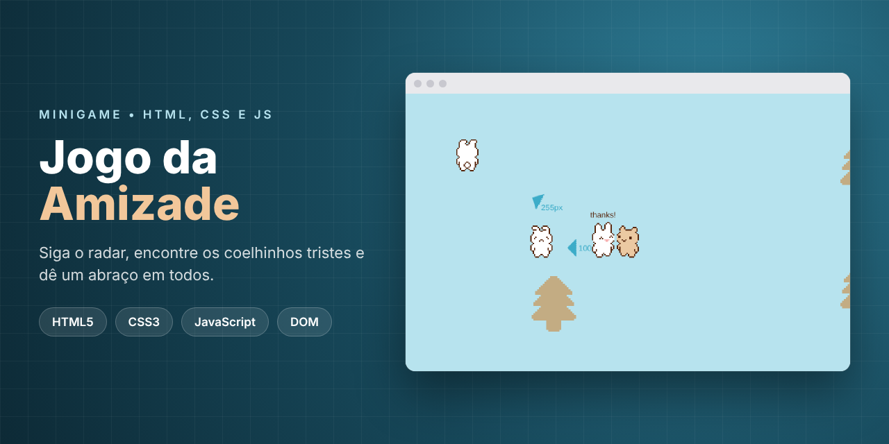
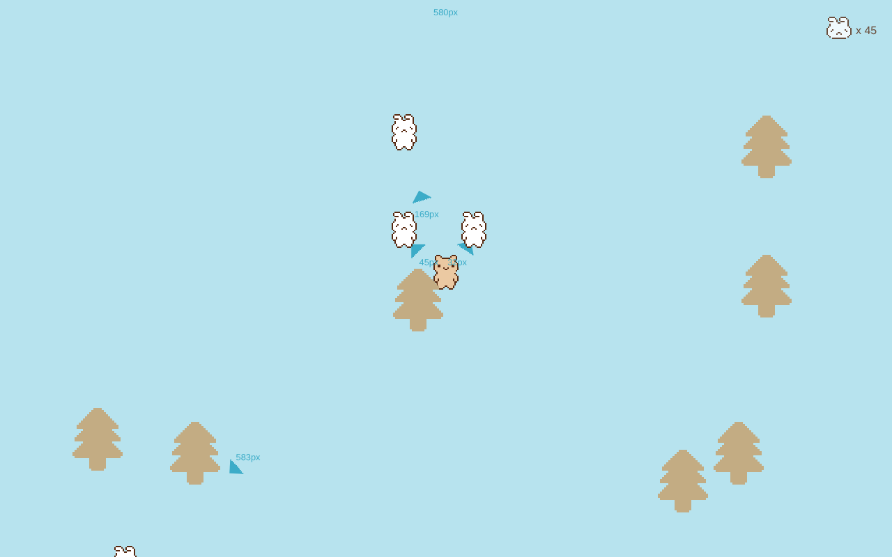
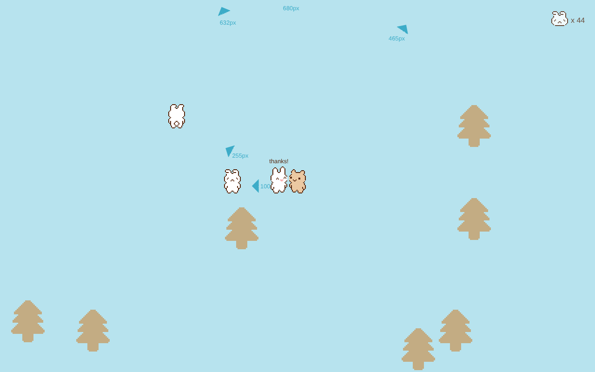
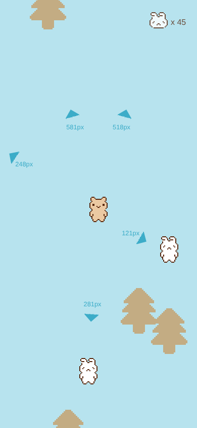

<p align="center">
  
</p>

<h1 align="center">🐻🐰 Jogo da Amizade</h1>

<p align="center">
  Minigame feito só com <b>HTML5, CSS e JavaScript puro</b>, sem engine e sem <code>&lt;canvas&gt;</code>: controle
  um urso, use o radar para achar os coelhinhos tristes espalhados pelo mapa e dê um abraço em cada um.
</p>

<p align="center">
  
  
  
  
</p>

<p align="center">
  <a href="#-sobre-o-projeto">Sobre</a> •
  <a href="#-como-jogar">Como jogar</a> •
  <a href="#-funcionalidades">Funcionalidades</a> •
  <a href="#-telas">Telas</a> •
  <a href="#-como-executar">Como executar</a> •
  <a href="#-técnicas-usadas">Técnicas</a> •
  <a href="#-estrutura-do-projeto">Estrutura</a>
</p>

---

## 📌 Sobre o projeto

Um minigame simples e fofo, desenvolvido como projeto de estudo de **Design Web e Lógica de Programação**. O mapa
é gerado de forma aleatória a cada partida e todo o jogo roda com elementos HTML posicionados por JavaScript e
animados com CSS.

## 🎮 Como jogar

1. **Objetivo:** encontrar e abraçar todos os **45 coelhinhos tristes**.
2. **Movimentação:** **clique** (no computador) ou **toque** (no celular) no ponto da tela para onde o urso deve ir.
3. **Radar:** as setas ao redor do urso apontam para os **5 coelhos tristes mais próximos** e mostram a distância
   de cada um em pixels.
4. **Abraço:** encoste no coelho para abraçá-lo. Ele agradece e o contador no canto superior direito diminui.
5. Quando não sobrar nenhum coelho triste, aparece a mensagem final com o botão para jogar de novo.

## ✨ Funcionalidades

| | Recurso | Descrição |
|---|---|---|
| 🗺️ | **Mapa aleatório** | Mapa de 4000 × 4000 px com 45 coelhos e 100 árvores em posições sorteadas a cada partida |
| 🧭 | **Radar** | Setas com ângulo e distância até os 5 coelhos tristes mais próximos |
| 🤗 | **Abraço animado** | Urso e coelho se abraçam e o coelho deixa uma mensagem de agradecimento |
| 🐇 | **Coelhos que andam** | Parte dos coelhos passeia sozinha pelo mapa |
| 🌲 | **Colisões** | Árvores, bordas do mapa e outros personagens bloqueiam a passagem |
| 🔢 | **Contador** | Quantidade de coelhos tristes restantes |
| 🎞️ | **Sprites animados** | Personagens andando nas quatro direções com sprites em CSS |
| 📱 | **Responsivo** | Mapa e radar se ajustam ao tamanho da janela; funciona com toque |

## 🖼️ Telas

<table>
  <tr>
    <td align="center"><b>Início da partida</b><br></td>
    <td align="center"><b>Abraço no coelhinho</b><br></td>
  </tr>
  <tr>
    <td align="center" colspan="2"><b>Celular</b><br></td>
  </tr>
</table>

## 🚀 Como executar

Não há build nem dependências:

```bash
git clone https://github.com/kauaxp77/Jogo-Da-Amizade.git
cd Jogo-Da-Amizade
```

Depois, abra o arquivo `index.html` em qualquer navegador e jogue!

## 🧠 Técnicas usadas

* **Engine em DOM:** em vez do `<canvas>`, os elementos do jogo são `div`s sobrepostas, e o JavaScript calcula as
  posições direto no CSS (`left`, `top`, `z-index`).
* **Animação com sprites em CSS:** a caminhada e a troca de direção dos personagens combinam `background-position`
  com imagens de sprite embutidas no CSS, controladas pelo JavaScript.
* **Radar com trigonometria:** `Math.atan2(y, x)` calcula o ângulo entre o urso e cada coelho para girar a seta na
  direção certa.
* **Distância euclidiana (Pitágoras):** `Math.sqrt(Math.pow(Δx, 2) + Math.pow(Δy, 2))` ordena os coelhos mais
  próximos e mede a proximidade de obstáculos.
* **Colisões:** antes de cada passo, o jogo verifica as árvores, os limites do mapa e os outros personagens,
  impedindo que alguém atravesse bordas e objetos.
* **Geração procedural:** `player`, `trees` e `bunnies` são objetos criados em arrays, com posições aleatórias a
  cada partida.

## 📁 Estrutura do projeto

```
Jogo-Da-Amizade/
├── index.html      # Estrutura da página: mapa, urso, radar, contador e mensagem final
├── style.css       # Estilos, sprites (imagens embutidas em base64) e animações
├── index.js        # Lógica do jogo: movimento, colisões, radar, abraços e geração do mapa
└── docs/
    ├── banner.png
    └── screenshots/    # Capturas de tela deste README
```

## 🛠️ Tecnologias

- **HTML5**
- **CSS3**: posicionamento, sprites e animações
- **JavaScript (Vanilla)**: lógica do jogo, sem bibliotecas

## 👨‍💻 Autor

Desenvolvido por **[kauaxp77](https://github.com/kauaxp77)** como projeto de estudo de Design Web e Lógica de
Programação.

<p align="center">⭐ Se curtiu o projeto, deixe uma estrela!</p>
